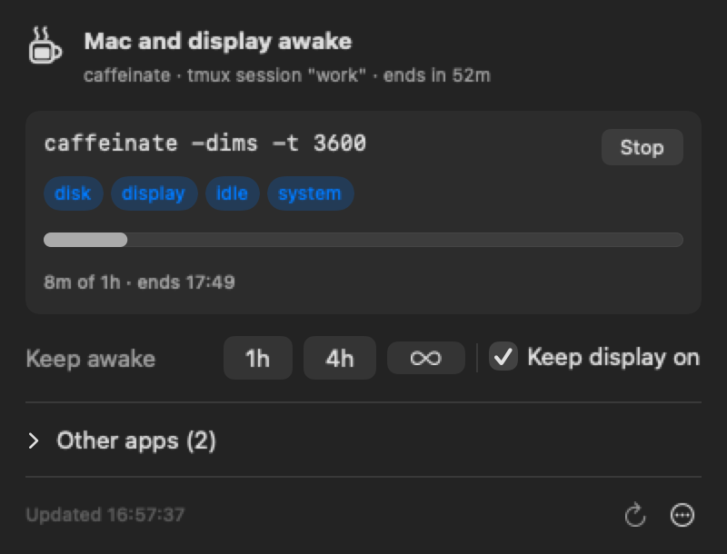

# caffeine-watch

A macOS menu bar app (and CLI) that shows whether something is keeping your Mac awake, and what.

Handy when you run `caffeinate` in a tmux session or background job and want to know at a glance that it is still running, how long it has been up, and which session owns it.




| Icon | Meaning |
| --- | --- |
| Steaming mug | `caffeinate` is running and preventing sleep |
| Full mug | No `caffeinate`, but another app is preventing sleep (a video call, a download, Bluetooth, …) |
| Empty mug | Nothing is preventing sleep; the Mac will sleep on its normal schedule |

Click the icon for details on every process that holds a sleep assertion:

- the full command line, e.g. `caffeinate -dims`, and which tmux session or parent started it
- what it prevents: display, idle, system or disk sleep
- for a timed `caffeinate`, a progress bar and the time it ends (the time left also shows next to the menu bar icon)
- other apps by name and icon; hover a row for its command line, pid, parent and uptime

Actions: **Keep awake** for 1 hour, 4 hours or until stopped, with or without the display, and **Stop** a `caffeinate` process (asks first). The **⋯** menu has **Turn display off now**, **Launch at login** and **Quit**.

Right-click the menu bar icon to keep awake, stop `caffeinate` or turn the display off without opening the popover.

## Install

### Homebrew

Requires macOS 13 Ventura or later, Apple silicon or Intel.

```sh
brew trust --cask omarhoumz/tap/caffeine-watch
brew install --cask omarhoumz/tap/caffeine-watch
```

Homebrew asks you to trust third-party taps once. This installs the app to `/Applications` and the `caffeine-watch` command; `brew upgrade` keeps both current.

### Download

Requires macOS 13 Ventura or later, Apple silicon or Intel.

1. Download `CaffeineWatch.zip` from the [latest release](https://github.com/omarhoumz/caffeine-watch/releases/latest) and unzip it.
2. Move `CaffeineWatch.app` to `/Applications` or `~/Applications`.
3. The app is not notarized, so macOS blocks the first launch. Open it once, then allow it in System Settings → Privacy & Security → **Open Anyway** (on macOS 13–14, right-click the app → **Open** also works). Or skip the prompt with:

   ```sh
   xattr -dr com.apple.quarantine ~/Applications/CaffeineWatch.app
   ```

4. Optional, for the CLI:

   ```sh
   ln -sf ~/Applications/CaffeineWatch.app/Contents/MacOS/CaffeineWatch ~/.local/bin/caffeine-watch
   ```

### Build from source

Requires macOS 13 Ventura or later and Swift 5.9+ (Xcode or the Command Line Tools: `xcode-select --install`).

```sh
git clone https://github.com/omarhoumz/caffeine-watch.git
cd caffeine-watch
./install.sh
```

This builds the app, copies it to `~/Applications`, links the `caffeine-watch` command into `~/.local/bin` (override with `BIN_DIR=/usr/local/bin ./install.sh`), and launches it.

To start it at login, tick **Launch at login** in the popover. If the toggle springs back off (macOS can refuse ad-hoc signed apps), add it in System Settings → General → Login Items, or run:

```sh
osascript -e 'tell application "System Events" to make login item at end with properties {path:(POSIX path of (path to home folder)) & "Applications/CaffeineWatch.app", hidden:false}'
```

To uninstall, quit the app, remove it from Login Items, then:

```sh
rm -rf ~/Applications/CaffeineWatch.app ~/.local/bin/caffeine-watch
```

## Use

The menu bar icon updates every 5 seconds. Click it for details.

From a terminal:

```sh
caffeine-watch                     # same as `caffeine-watch status`
caffeine-watch start 2h --display  # keep the Mac and display awake for 2 hours
caffeine-watch start               # keep the Mac awake until stopped (display may sleep)
caffeine-watch stop                # stop every caffeinate; `stop <pid>` for one
caffeine-watch check               # silent; exit 0 if caffeinate is running, 1 otherwise
caffeine-watch help
```

```
caffeinate is keeping the Mac awake
  caffeinate -dims
    pid 57814 · tmux session "work" · up 3d 4h
    prevents: disk idle, display, idle system, system sleep
Other apps:
  /usr/sbin/bluetoothd
    pid 162 · launchd (1) · up 35d 3h
    prevents: idle system
```

`start` runs `/usr/bin/caffeinate -ims` (plus `-d` with `--display`, `-t` with a duration) in its own session, so it keeps running after the terminal or the app closes. Durations: `90` (seconds), `45m`, `2h`, `1h30m`, `1d`.

Shell completions for zsh, bash and fish come with the Homebrew cask. From a source build, they are in `completions/`.

`check` is for scripts:

```sh
caffeine-watch check || caffeine-watch start
```

## How it works

Every 5 seconds the app calls `IOPMCopyAssertionsByProcess` (IOKit, the same data `pmset -g assertions` prints) to list the processes holding power assertions. macOS posts no usable notification when assertions change, so this is a poll, but a cheap one: a single system call.

When a process appears for the first time, it also runs:

- `ps` for its command line, start time and parent chain
- `tmux list-panes -a` (when tmux is installed) to map the process or its ancestors to a session name

Each `caffeinate` is also watched for exit, so the icon changes the moment one stops.

Assertions that are always present are ignored: powerd's "prevent sleep while display is on", WindowServer's `UserIsActive`, and `BackgroundTask`. Without this the icon would never show idle.

Nothing runs as root and nothing leaves the machine.

## Develop

```sh
swift build                                  # debug build
swift run CaffeineWatch status               # CLI, no app bundle needed
./build.sh && open build/CaffeineWatch.app   # run the menu bar app from the repo
```

| Path | What |
| --- | --- |
| `Sources/CaffeineWatch/Assertions.swift` | Reads power assertions from IOKit, decides what counts as preventing sleep |
| `Sources/CaffeineWatch/Poller.swift` | Adds `ps` / `tmux` details and builds a snapshot |
| `Sources/CaffeineWatch/KeepAwake.swift` | Starts and stops `caffeinate` |
| `Sources/CaffeineWatch/App.swift` | Status item, SwiftUI popover and right-click menu |
| `Sources/CaffeineWatch/AppIdentity.swift` | App name and icon for a process, with names for common system daemons |
| `Sources/CaffeineWatch/Icon.swift` | Menu bar icon, drawn in code as a template image |
| `Sources/CaffeineWatch/main.swift` | Entry point: CLI commands, or the app when launched bare |
| `scripts/make-icon.swift` | Regenerates `Resources/AppIcon.icns` (`swift scripts/make-icon.swift`) |
| `build.sh` | Builds the `.app` bundle (`LSUIElement`, so no Dock icon) and ad-hoc signs it |
| `install.sh` | Builds, installs to `~/Applications`, links the CLI |
| `completions/` | zsh, bash and fish completions, bundled into the app's Resources |

There is no Xcode project; Swift Package Manager plus `build.sh` is the whole build. `build.sh` stamps the version from the latest git tag (or `VERSION=1.2.3 ./build.sh`).

## Contribute

Issues and pull requests are welcome. See [CONTRIBUTING.md](CONTRIBUTING.md).

## License

[MIT](LICENSE)
