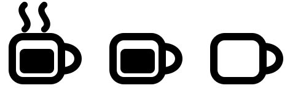

# caffeine-watch

A macOS menu bar app (and CLI) that shows whether something is keeping your Mac awake, and what.

Handy when you run `caffeinate` in a tmux session or background job and want to know at a glance that it is still running, how long it has been up, and which session owns it.



| Icon | Meaning |
| --- | --- |
| Steaming mug | `caffeinate` is running and preventing sleep |
| Full mug | No `caffeinate`, but another app is preventing sleep (a video call, a download, Bluetooth, …) |
| Empty mug | Nothing is preventing sleep; the Mac will sleep on its normal schedule |

Click the icon for details on every process that holds a sleep assertion:

- the full command line, e.g. `caffeinate -dims`
- pid, and its parent, shown as the tmux session name when it runs inside tmux
- how long it has been running
- what it prevents: display sleep, idle system sleep, system sleep, disk idle

Actions: **Kill** a `caffeinate` process (asks first), **Turn display off now**, **Launch at login**, **Quit**.

## Requirements

- macOS 13 Ventura or later
- Swift 5.9+ (Xcode or the Command Line Tools: `xcode-select --install`)

## Install

```sh
git clone https://github.com/omarhoumz/caffeine-watch.git
cd caffeine-watch
./install.sh
```

This builds the app, copies it to `~/Applications`, links the `caffeine-watch` command into `~/.local/bin` (override with `BIN_DIR=/usr/local/bin ./install.sh`), and launches it.

To start it at login, tick **Launch at login** in the popover. If the toggle springs back off (macOS can refuse ad-hoc signed apps), add it in System Settings → General → Login Items, or run:

```sh
osascript -e 'tell application "System Events" to make login item at end with properties {path:(POSIX path of (path to home folder)) & "Applications/CaffeineWatch.app", hidden:false}'
```

To uninstall, quit the app, remove it from Login Items, then:

```sh
rm -rf ~/Applications/CaffeineWatch.app ~/.local/bin/caffeine-watch
```

## Use

The menu bar icon updates every 5 seconds. Click it for details.

From a terminal:

```sh
caffeine-watch status
```

```
caffeinate is keeping the Mac awake
  caffeinate -dims
    pid 57814 · tmux session "work" · up 3d 4h
    prevents: disk idle, display, idle system, system sleep
Other apps:
  /usr/sbin/bluetoothd
    pid 162 · launchd (1) · up 35d 3h
    prevents: idle system
```

For scripts, `check` prints nothing and exits 0 while `caffeinate` is running, 1 otherwise:

```sh
caffeine-watch check || caffeinate -dims &
```

## How it works

Every 5 seconds the app runs:

- `pmset -g assertions` to list the processes holding power assertions
- `ps` for each holder's command line, uptime and parent chain
- `tmux list-panes -a` (when tmux is installed) to map a process or its ancestors to a session name

Assertions that are always present are ignored: powerd's "prevent sleep while display is on", WindowServer's `UserIsActive`, and `BackgroundTask`. Without this the icon would never show idle.

Nothing runs as root and nothing leaves the machine.

## Develop

```sh
swift build                                  # debug build
swift run CaffeineWatch status               # CLI output, no app bundle needed
./build.sh && open build/CaffeineWatch.app   # run the menu bar app from the repo
```

| Path | What |
| --- | --- |
| `Sources/CaffeineWatch/Parser.swift` | Parses `pmset -g assertions`, decides what counts as preventing sleep |
| `Sources/CaffeineWatch/Poller.swift` | Runs `pmset` / `ps` / `tmux` and builds a snapshot |
| `Sources/CaffeineWatch/App.swift` | SwiftUI `MenuBarExtra` and popover |
| `Sources/CaffeineWatch/Icon.swift` | Menu bar icon, drawn in code as a template image |
| `Sources/CaffeineWatch/main.swift` | Entry point: `status` CLI or the app |
| `scripts/make-icon.swift` | Regenerates `Resources/AppIcon.icns` (`swift scripts/make-icon.swift`) |
| `build.sh` | Builds the `.app` bundle (`LSUIElement`, so no Dock icon) and ad-hoc signs it |
| `install.sh` | Builds, installs to `~/Applications`, links the CLI |

There is no Xcode project; Swift Package Manager plus `build.sh` is the whole build.

## Contribute

Issues and pull requests are welcome. See [CONTRIBUTING.md](CONTRIBUTING.md).

## License

[MIT](LICENSE)
